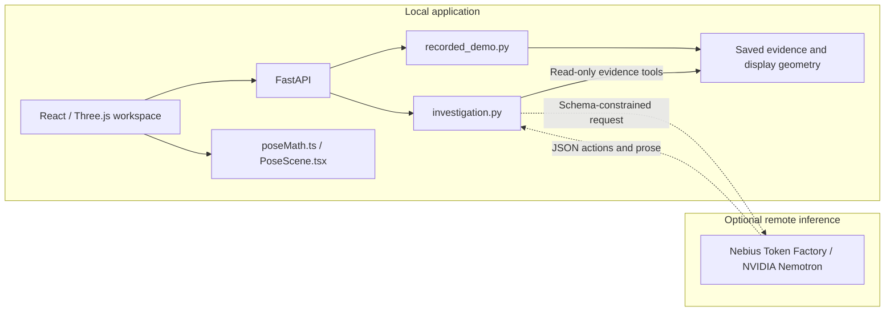

<a href="https://youtu.be/dfL55NZeDBQ"></a>

[Watch the Demo Video](https://youtu.be/dfL55NZeDBQ)

# AutoFrame 3D

**Expose the wrong poses that pass your checks.**

A convincing CAD-to-scan fit can still represent an incorrect pose. AutoFrame 3D
helps registration reviewers inspect that gap: explore saved CAD/scan alignments,
compare recorded methods, reveal benchmark ground truth, and download the evidence
behind geometric acceptance and benchmark correctness.

[Quick Start](#quick-start) · [Features](#demonstrated-features) · [Architecture](#architecture) · [Evidence](#evaluation-and-reproducibility)

*The preview is a genuine application screenshot. The selected conceptual cover
remains local pending confirmation of redistribution permission. Video content
and duration have not been independently verified. This project is not deployed: **run locally**.*

## Why AutoFrame 3D

Fitness and inlier RMSE measure geometric agreement, not certainty that a pose is
correct. Partial observations, similar shapes and symmetry can make the distinction
hard to see. AutoFrame 3D puts the saved alignment, thresholds and benchmark pose
error side by side so reviewers can examine the result instead of relying on a
single acceptance flag.

The recorded demonstration uses two curated T-LESS cases. One is geometrically
accepted but incorrect; the other shows a recorded refinement whose RMSE improves
while benchmark correctness worsens. They are reviewable examples, not a claim of
improved registration accuracy or a representative benchmark sample.

## Demonstrated features

- **Inspect CAD and scan geometry.** Select a saved case, orbit the view, switch
  available recorded methods and toggle **Benchmark ground truth**.
- **Separate two decisions.** See **Geometric acceptance** alongside
  **Symmetry-aware pose correctness**, with explicit thresholds and GT dependence.
- **Download evidence.** Export saved records, method comparisons, configuration
  and provenance. Opening a case does not run registration.
- **Explore a synthetic pose.** Preview a five-second interpolation toward a known
  reference, pause/reset it and export state with the original estimate preserved.
  This is reference-guided visualization, not learned recovery or robot control.
- **Review bounded AI explanations.** The experimental copilot can retrieve approved
  evidence cards and produce cited prose. Deterministic scope notes are separate
  from model prose; operational errors are separate from abstention. Current
  grounded-answer quality remains unverified.

## Application screenshot


Actual production UI captured on 2026-10-28: saved reciprocal method, accepted
geometry, incorrect GT-scored pose and the baseline comparison. This genuine
interface capture shows the local recorded-inspection workflow. The
[synthetic workspace screenshot](docs/screenshots/synthetic_desktop.png) and
[screenshot notices](docs/screenshots/NOTICE.md) provide the other view and attribution.

## Modes at a glance

| Mode | What happens | Scope |
| --- | --- | --- |
| Synthetic | Procedural gripper preview; separate CLI experiments compute seeded classical registration | Known-reference preview and generated-data experiments; no physical scanner validation |
| Recorded benchmark | Loads saved geometry, poses and metrics; compares methods and exports evidence | Two curated T-LESS cases; GT instance masks/known identity used as inputs, benchmark GT used for correctness |
| Experimental AI | Optional Nemotron inference requests read-only evidence tools and explains returned cards | Strict bounded workflow; historical answers/failures preserved, current end-to-end quality unverified |

## Quick Start

**Run locally on Windows.** Recorded and synthetic views need no API key, full
T-LESS dataset or GPU. The tested release environment used Python **3.13.7**,
Node **24.14.1** and npm **11.11.0**. The package declares Python 3.10+; other
OS/version combinations remain unverified. Use Node compatible with Vite 7.

From the checkout root, install the editable Python package and locked frontend:

```powershell
python -m venv .venv
.venv/Scripts/python.exe -m pip install -e '.[test]'
npm.cmd ci --prefix frontend
```

Keep `demo_assets/`, `audit_evidence/` and `frontend/public/assets/` beside the
source. Runtime files are read from the checkout; standalone wheel execution is
not verified. [Prior setup verification](docs/setup-verification.md) records the
clean-install evidence and Windows interpreter workarounds.

Start the backend in one terminal, with port 8000 free:

```powershell
$env:AUTOFRAME3D_SKIP_DOTENV='1'
Remove-Item Env:NEBIUS_API_KEY -ErrorAction SilentlyContinue
.venv/Scripts/python.exe -m uvicorn autoframe3d.api:app --host 127.0.0.1 --port 8000
```

Start the frontend in another terminal:

```powershell
npm.cmd run dev --prefix frontend -- --port 5173 --strictPort
```

Open **http://127.0.0.1:5173** locally. The Vite development proxy targets API
port 8000. Stop your own servers with Ctrl+C; leave other checkouts' services
untouched. If a port is occupied, choose free ports and adjust the proxy to match.

### Offline and optional live configuration

The commands above disable dotenv and clear the backend terminal's key for the
offline walkthrough. `api.py` otherwise reads a root `.env` by default, without
overriding existing process values. `AUTOFRAME3D_SKIP_DOTENV=1` disables that read.
Diagnostic/evaluation scripts do not load `.env`. Never put a key in frontend
configuration, source, recordings or committed commands.

For an explicitly authorized investigation-only validation, the existing secure
launcher prompts with hidden input and supplies the key only to its child process:

```powershell
& ./scripts/run_release_validation.ps1 -InvestigationOnly
```

**This command makes paid requests.** It selects only development dev-01/dev-02/
dev-13 once each, with nine provider requests maximum, no retries and fresh GUID
output paths. HTTP/configuration rejection stops remaining items. Without the
switch, the default sequence requires a separate 128-token diagnostic to succeed
first and permits ten requests maximum. Do not run both modes or retry failed
items under the same authorization. See the [review checklist](docs/final-release-verification.md)
and [launcher source](scripts/run_release_validation.ps1) before execution.

## Judge walkthrough

1. Open **Recorded Benchmark** and select **A · Geometrically accepted, incorrect
   pose**. Reveal **Benchmark ground truth** and compare the acceptance and
   correctness decisions; read the GT-mask/benchmark-GT qualifications.
2. Select **B · Lower RMSE, worse pose**. Switch **Recorded method** between baseline
   and reciprocal. The recorded RMSE decreases while pose correctness regresses;
   the reciprocal result remains explicitly experimental.
3. Choose **Download recorded evidence** and inspect its saved cases, method
   records, thresholds and source hashes. No new fitting is performed.
4. Return to **Pose Inspection**. Use **Preview correction · 5 sec**, pause,
   **Reset estimate** and **Export synthetic state**. The reference is known.
5. Treat the **Experimental live copilot** according to its actual availability
   and saved results. A fixture, historical recording or provider error is not a
   new live answer.

[Submission fields and narration plan](docs/submission-ready.md) ·
[Watch the Demo Video](https://youtu.be/dfL55NZeDBQ) ·
[Optional Google Drive backup](https://drive.google.com/file/d/1qpVvW9SfT1RpIhEUCSIbKb80J4Md0DdW/view?usp=sharing)

## NVIDIA Nemotron and Nebius Token Factory

The shared default is **`nvidia/Nemotron-3_5-Lightning`** in
[nebius.py](autoframe3d/nebius.py). The investigation and diagnostic use the
configured `NEBIUS_MODEL` through `model_name()`; they are not fixed to the
128-token probe's settings. The separate research proposal path in
[agent.py](autoframe3d/agent.py) also reads the override directly. Identifier
validation is not proof that an account can use a particular model.

Nebius Token Factory supplies optional server-side inference through the fixed
`https://api.tokenfactory.nebius.com/v1/chat/completions` endpoint. The implemented
language-model roles are distinct from geometry computation:

| Workflow | Model role | Application role |
| --- | --- | --- |
| Recorded-evidence investigation | Select catalogue/case/comparison/summary tools; synthesize cited findings or insufficient evidence | Validate actions and retrieved citations; derive labels from frozen recorded metrics; retain provenance |
| Separate synthetic research campaign | Propose bounded experiment parameters from measured results | Validate proposals and execute classical geometric experiments locally; apply separate campaign budgets |

Nemotron does not compute the saved registrations, change benchmark GT or perform
autonomous pose correction. The recorded viewer and synthetic preview work locally
without inference. Operational errors never substitute a cached answer for an
investigation; an unavailable-comparison card states the missing comparison.

An **investigation** retains three requests, six tool attempts and a 60-second
deadline, with at most 20 seconds/request, 1,200 output tokens and 32 KiB accepted
response. These are investigation limits, not universal settings for the separate
proposal workflow. Strict schemas, citation validation and allowlists remain in
place; redirects are rejected. [Compatibility and validation details](docs/final-release-verification.md).

## Architecture



The diagram shows the demonstrated recorded/synthetic UI and optional evidence
copilot. The separate research campaign uses `campaign.py`, `agent.py` and
`experiment.py`; it is not the recorded inspection path. Offline
[answer evaluation](autoframe3d/answer_evaluation.py) checks returned cards and
traces against authoritative records. Human review is still required for prose
entailment, completeness and unsupported conclusions.

## Evaluation and reproducibility

For the curated recorded T-LESS cases:

| Decision or quantity | Meaning |
| --- | --- |
| Geometric acceptance | Fitness >= 0.70 **and** recorded inlier RMSE <= 10 mm |
| Fitness | Fraction of scan points with a model neighbour inside the configured gate |
| Correspondence gate | 15 mm configured matching distance; not a measured residual or a third acceptance test |
| Benchmark correctness | Symmetry-aware MSSD / object diameter <= 0.10, scored using benchmark GT and model symmetry metadata |

GT instance masks and known object identity were registration inputs. Benchmark
GT is required to score correctness; geometric acceptance alone does not establish
it. Synthetic experiments use different thresholds. Coordinates are right-handed
metres; homogeneous transforms use column vectors. Saved pose/display conversions
are documented in the [recorded demo](DEMO.md) and [engineering handoff](docs/engineering-handoff.md).

Exact results and source identities are in the [benchmark report](BENCHMARK_REPORT.md),
[display manifest](demo_assets/manifest.json) and [scoring audit](audit_evidence/symmetry_scoring_audit_20261011_02a10626368f/README.md).
This is a custom internal evaluation, **not an official BOP score**. The corrected
historical held-out count is 24 accepted-and-correct / 176 accepted-but-wrong:
21 affected records were rescored and 179 labels carried forward, not a full
independent rescore. No new benchmark or fitting run is claimed here.

### Actual checks and model evidence

[Release verification](docs/final-release-verification.md) and the
[portable check record](audit_evidence/release_verification_20261028/checks.json)
identify tested source, date and scope. Recorded release checks include 122 backend
passes with one optional raw-source rebuild skipped, eight frontend passes and a
production build with an existing >500 kB bundle warning. Actual Edge checks
covered recorded comparisons/GT/export, synthetic pause/reset/export, desktop/mobile
layout and separately intercepted error fixtures. These are not live-model tests.

| Saved model run | Result to retain |
| --- | --- |
| Original three-item dev-01 | Supported numerical/RMSE comparisons; omitted recorded/GT qualifications; no measured-gate claim |
| Earlier separate dev-01 | Unsupported measured 0.015 m gate claim; distinct capture |
| Original dev-02 / dev-13 | Unavailable single-method comparison / third-turn truncation |
| Later two-item run | HTTP 401 with invalid_request_error; zero tools/findings, underlying cause unresolved |
| Latest user-run diagnostic | One response, finish_reason=length at 128 completion tokens; no investigations ran |

The original batch attempted 3/15 development items and the later batch 2/15
separately. No newer investigation-only result was found in saved output. Response
receipt is not valid diagnostic output or grounded-answer quality. The earlier
missing-key state is historical, not the current explanation for this truncation.
[Distinct captures and manual reviews](docs/evidence-grounding-validation.md)
preserve failures and unattempted denominators. Schema/status/citation validity
alone is not semantic correctness.

For a separate seeded synthetic control, the existing CLI computes a new result:

```powershell
.venv/Scripts/python.exe -m autoframe3d.cli run --object near_symmetric --visibility all --seed 41 --yaw 0 --output artifacts/synthetic-control
```

This is generated-data registration, not a recorded-viewer action or inference.
Raw-data rebuild/replay needs separately authorized source inputs; see
[data preparation and permissions](docs/data-permissions.md).

## Current scope and next steps

The working local demonstration is recorded evidence inspection plus a synthetic
reference-guided preview. It does not establish GT-free detection, reliable live
AI, physical scanner operation, autonomous recovery, improved registration
accuracy or industrial safety.

- **Live quality:** complete an authorized investigation-only run and manually
  review actual findings, pairing, numbers/units, citations and GT qualifications.
  Preserve failed attempts; do not silently retry or increase budgets.
- **Research reproduction:** the completeness audit restored the omitted
  `_refine_icp` implementation and its tests from the source checkout, and fixed
  temporary worker-guard cleanup. The dataset-independent backend suite passed
  189 tests with one skip; four raw-data API tests still require absent T-LESS
  inputs and were excluded from that run. A full raw-data/fresh-machine pass is
  not claimed. See the [completeness audit](docs/repository-completeness.md).
- **Portability:** standalone wheels, other OS environments and raw-data refits
  remain unverified. The production bundle has a size advisory. No fresh application
  tests/build were run for this README/image-only update.
- **Submission:** the project is not deployed. Managed judge access and final
  owner confirmations remain pending. The supplied YouTube URL does not constitute
  independent review of the video's content or duration.
- **Data permissions:** the exact governing T-LESS source grant remains unresolved;
  preserve its existing attribution and ShareAlike treatment. Project MIT does
  not settle third-party rights.

<details>
<summary>Troubleshooting and verification commands</summary>

Missing live availability is a process-key configuration check; recorded/synthetic
views need no key. Saved HTTP 401 establishes only status/category: no expired-key,
billing or model cause is proven. A schema rejection should be inspected through
sanitized diagnostics. Truncated output is rejected, not treated as abstention.
Do not repeat paid requests or change limits without authorization.

The source-backed local verification commands are:

```powershell
$env:AUTOFRAME3D_SKIP_DOTENV='1'
.venv/Scripts/python.exe -B -m pytest -q --tb=short -p no:cacheprovider
node --test frontend/tests/*.test.mjs
node --max-old-space-size=384 --max-semi-space-size=2 frontend/node_modules/typescript/bin/tsc -b frontend
Push-Location frontend
try { node --max-old-space-size=384 --max-semi-space-size=2 node_modules/vite/bin/vite.js build } finally { Pop-Location }
```

The full backend command includes the still-unavailable raw-data API inputs. Explicit
Node heap settings were used after observed memory failures. These commands are
provided for reproduction, not reported as newly executed in this edit.

</details>

## Repository map

| Path | Purpose |
| --- | --- |
| `autoframe3d/recorded_demo.py`, `demo_assets/` | Saved cards, two display geometries and provenance |
| `autoframe3d/investigation.py`, `nebius.py` | Bounded evidence actions and shared inference transport |
| `autoframe3d/agent.py`, `campaign.py`, `experiment.py` | Separate proposal and local experiment workflows |
| `autoframe3d/answer_evaluation.py` | Offline fact/trace evaluation with manual semantic review |
| `frontend/src/` | Recorded workspace, synthetic scene and pose math |
| `scripts/validate_release_live.py` | Default diagnostic sequence or explicit nine-request investigation-only mode |
| `scripts/run_release_validation.ps1` | Secure child-process credential launcher |
| `tests/`, `frontend/tests/` | Backend, browser and frontend checks |
| `audit_evidence/` | Preserved captures, rubric, results and audits |
| `docs/` | Setup, verification, permission review and submission fields |

Repository authors are **Muskan Ejaz** and **Juwairiya-Haroon**. The handoff identifies
Muskan as lead and Juwairiya as engineering contributor; Git author labels do not
prove every individual contribution. [Submission-period history and disclosure](docs/submission-ready.md#significant-hackathon-period-updates)
record the verified changes and remaining owner confirmations. AI coding assistance
was used for release repair, tests and documentation.

## License and third-party notices

Original project code is [MIT](LICENSE), approved by both owners. Third-party
material retains its own terms: Panda Apache-2.0, Poly Haven HDR CC0, existing
MIT local-scene assets, dependency licenses and T-LESS attribution/ShareAlike
bundle terms. No third-party material is relicensed. The selected conceptual
cover is withheld from publication until its redistribution permission is confirmed.

[Industrial asset notices](frontend/public/assets/industrial/NOTICE.md) ·
[T-LESS attribution](demo_assets/ATTRIBUTION.md) · [Screenshot notices](docs/screenshots/NOTICE.md) ·
[Data-permission review and alternative setup](docs/data-permissions.md)

[Copy-ready submission fields and judge instructions](docs/submission-ready.md) ·
[Requirements](docs/hackathon-requirements.md) · [Setup evidence](docs/setup-verification.md) ·
[Detailed grounding history](docs/evidence-grounding-validation.md)
