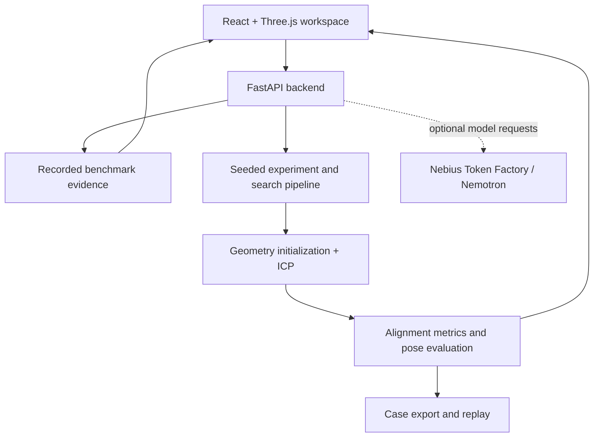

<p align="center">
  <a href="https://youtu.be/dfL55NZeDBQ">
    
  </a>
</p>

[Watch the Demo Video](https://youtu.be/dfL55NZeDBQ)

<h2 align="center">Watch AutoFrame 3D in Action</h2>

<p align="center">
  <a href="https://youtu.be/dfL55NZeDBQ">
    
  </a>
</p>

<p align="center"><a href="https://youtu.be/dfL55NZeDBQ"><strong>Watch the Demo Video</strong></a></p>

# AutoFrame 3D

### Expose the wrong poses that pass your checks.

**An interactive scan-to-CAD inspection and registration stress-testing workspace for understanding when a convincing alignment should be questioned.**

AutoFrame 3D brings CAD overlays, pose inspection, registration metrics and benchmark evidence into one workflow. Explore a pose mismatch in 3D, compare recorded method results, reveal benchmark ground truth and export the evidence behind a result.

**Run locally using the setup instructions below.** The project has not been deployed. The user-provided YouTube link is a recorded demonstration; its content and duration have not been independently verified. The cover is conceptual artwork, not an application screenshot, scanner output or physical experiment.


[Why it matters](#1-why-it-matters) · [Features](#2-demonstrated-capabilities) · [Quick start](#5-local-setup-windows-powershell) · [Architecture](#7-technical-architecture) · [Evidence](#9-benchmark-evidence-and-reproducibility)

---

## 1. Why it matters

A low alignment error answers a geometric question: **how closely do these points fit?** It does not necessarily answer the operational question: **is this the correct pose?**

Symmetry, repeated surfaces and incomplete visibility can make the wrong orientation look plausible. An inspection workflow needs to expose this ambiguity before a result is trusted downstream.

AutoFrame 3D makes that distinction inspectable. It is designed for researchers and engineers evaluating CAD registration, investigating failure cases and explaining results to people who need more than a single score.

> **Core principle: geometric acceptance and pose correctness are separate decisions.**

## 2. Demonstrated capabilities

| Capability | What you can do |
| --- | --- |
| Interactive pose inspection | Explore an incorrect CAD overlay and a reference-guided synthetic correction in a robot/gripper scene. |
| Recorded benchmark exploration | Inspect saved T-LESS geometry, estimated poses and measured results without running a new registration. |
| Acceptance versus correctness | See how an alignment can pass configured geometric thresholds while failing the benchmark pose criterion. |
| Ground-truth reveal | Reveal benchmark reference poses separately from estimated results. |
| Method comparison | Compare available saved method results for a selected case. |
| Evidence export | Download supported case evidence, metrics and provenance for review. |
| Reproducible experiments | Generate seeded synthetic scans and run bounded registration searches. |
| Replay and simplification | Recompute supported exported experiments and inspect failures preserved by a bounded simplification procedure. |
| Experimental NVIDIA integration | Connect optional model-assisted workflows to Nemotron through Nebius Token Factory. |

## 3. Choose the right mode

| Mode | Input | Main purpose | Provider key |
| --- | --- | --- | --- |
| **Pose Inspection** | Synthetic scene and reference pose | Explain spatial mismatch through an interactive visualization | Not required |
| **Recorded Benchmark** | Saved benchmark geometry, poses and metrics | Inspect reproducible evidence and compare saved results | Not required for recorded viewing |
| **Local experiments** | Procedural CAD-like objects and seeded scan generation | Run registration, bounded search, export and replay | Not required for deterministic runs |
| **Experimental model-assisted workflows** | Structured experiment or investigation context | Explore bounded proposals and evidence interpretation | Required for remote inference |

The synthetic correction is reference-guided animation. Recorded viewing loads saved results. Fresh registration is an explicit experiment or replay action. These modes make different claims and are labelled accordingly.

## 4. A short walkthrough for judges

1. Launch the local backend and frontend using the instructions below.
2. Open **Pose Inspection** and examine the initial mismatch between the part and CAD overlay.
3. Play the synthetic correction to understand the spatial relationship.
4. Switch to **Recorded Benchmark** and select a saved case.
5. Inspect geometric acceptance and the available registration metrics.
6. Reveal benchmark ground truth and compare pose correctness with acceptance.
7. Compare available method results and download the evidence.

This walkthrough demonstrates the inspection experience without requiring a provider key or a full dataset download. See [DEMO.md](DEMO.md) for the recorded-flow details and [POSE_INSPECTION.md](POSE_INSPECTION.md) for synthetic coordinate conventions.

## 5. Local setup: Windows PowerShell

### Prerequisites

- Python **3.10 or newer**; the documented historical Windows setup used Python 3.12.7.
- Node.js **20.19+ or 22.12+**, and npm.
- A complete repository checkout, including its required demo assets.

Use this publication branch for the combined inspection UI and release behavior:

```powershell
git clone --branch publish/local-updates-20261030 https://github.com/MuskanEjaz/AutoFrame-3D.git
cd AutoFrame-3D
```

### Install dependencies

```powershell
python --version
python -m venv .venv
.\.venv\Scripts\python.exe -m pip install --upgrade pip
.\.venv\Scripts\python.exe -m pip install -e ".[test]"
npm ci --prefix frontend
```

### Start the backend

Run from the repository root in the first terminal:

```powershell
$env:AUTOFRAME3D_SKIP_DOTENV='1'
Remove-Item Env:NEBIUS_API_KEY -ErrorAction SilentlyContinue
.\.venv\Scripts\python.exe -m uvicorn autoframe3d.api:app --host 127.0.0.1 --port 8000
```

### Start the interface

In a second terminal, from the same repository root:

```powershell
npm.cmd run dev --prefix frontend -- --port 5173 --strictPort
```

| Local service | Address |
| --- | --- |
| Application | http://127.0.0.1:5173 |
| API health | http://127.0.0.1:8000/api/health |

These are local development addresses. No deployment is needed. Virtual-environment activation is unnecessary because the backend commands use its Python executable directly.

Keep the checkout intact: the documented runtime reads assets from `demo_assets/` and `audit_evidence/` outside the Python package. An editable checkout is the supported documented route; standalone wheel installation is not verified.

## 6. NVIDIA Nemotron and Nebius Token Factory

AutoFrame 3D integrates optional server-side model access through **Nebius Token Factory**, with the configured default model identifier **`nvidia/Nemotron-3_5-Lightning`**.

The geometry pipeline remains responsible for registration and numerical evaluation. Model-assisted components add a separate layer for bounded experiment proposals and experimental evidence investigation. An explanation is assessed against the supplied evidence; it does not replace a geometric measurement or ground-truth correctness check.

The separate campaign uses strict proposal validation, at most four model calls and 12 total registrations. Recorded-evidence investigations instead permit three model requests, six tool attempts and 60 seconds, at most 20 seconds/request, 1,200 output tokens and 32 KiB accepted response. No retries or generated code/shell execution are permitted. The model chooses approved catalogue/case/comparison/summary tools and synthesizes prose; application code validates IDs/citations and computes labels from frozen recorded metrics. It cannot change registration.

The panel separates deterministic **Evidence scope** disclosures from model prose and shows allowlisted operational errors without treating them as abstention. **Download investigation response** exports the actual returned response/cards. An unavailable comparison does not satisfy the evaluator's requested comparison. [Source-backed release verification](docs/final-release-verification.md).

### Optional configuration

The offline launch above deliberately bypasses `.env`. To enable optional remote inference, configure the backend using `.env.example` and the release documentation, then restart it without `AUTOFRAME3D_SKIP_DOTENV=1` if using `.env` loading.

| Variable | Purpose |
| --- | --- |
| `NEBIUS_API_KEY` | Private backend provider credential |
| `NEBIUS_MODEL` | Server-side model selection where supported by the selected workflow |
| `AUTOFRAME3D_SKIP_DOTENV` | Bypass `.env` loading for an explicitly offline launch |

Keep the key out of source files, screenshots, frontend bundles and Git. Remote inference can incur charges. Run it explicitly within the selected workflow's limits.

**Validation scope:** a saved release diagnostic received a provider response but did not pass strict output validation. A completed end-to-end live investigation is not established by that diagnostic. The recorded demonstration remains reproducible independently of remote inference. The current investigation and diagnostic use `model_name()` and honor `NEBIUS_MODEL`; the separate proposal path also reads that override directly. Do not apply the diagnostic's 128-token setting to investigations or synthetic campaigns.

## 7. Technical architecture



The backend coordinates local computation and saved evidence. The frontend presents geometry and results. Optional remote model access stays on the server side.

### Main components

| Component | Responsibility |
| --- | --- |
| `autoframe3d/geometry.py` | Procedural meshes, seeded surface sampling, rigid transforms and declared symmetry handling |
| `autoframe3d/experiment.py` | Partial scan generation, geometry-based initialization and bounded point-to-point ICP |
| `autoframe3d/agent.py` | Validated bounded proposal interface |
| `autoframe3d/campaign.py` | Campaign coordination and evaluation budgets |
| `autoframe3d/simplify.py` | Bounded failure-preserving simplification |
| `autoframe3d/cases.py` | Portable synthetic case export and recomputing replay |
| `autoframe3d/api.py` | FastAPI endpoints and background job coordination |
| `autoframe3d/tless_*.py` | Dataset adaptation, metrics, manifests, recorded cases and benchmark/search workflows |
| `frontend/src/` | React/TypeScript interface and Three.js visualization |

## 8. Run a reproducible experiment

These commands perform computation; opening a recorded case does not. Use the virtual-environment executable to avoid accidentally selecting another installation.

### Full-visibility control

```powershell
.\.venv\Scripts\python.exe -m autoframe3d.cli run --object near_symmetric --visibility all --seed 41 --yaw 0 --output artifacts/control
```

### Bounded deterministic search

```powershell
.\.venv\Scripts\python.exe -m autoframe3d.cli search --budget 12 --output artifacts/search
```

The search writes per-case geometry, scan data, transforms, configuration, metrics and environment metadata. Inspect `artifacts/search/case-*/result.json` for case results.

### Control, failure, simplification and replay

```powershell
.\.venv\Scripts\python.exe scripts/demo.py
```

This demonstration runs a control and failure workflow, exports a supported case and performs actual replay. Synthetic replay regenerates and re-registers the case rather than treating saved measurements as newly computed results.

## 9. Benchmark evidence and reproducibility

The T-LESS evaluation is a **custom internal evaluation on the BOP19 PrimeSense subset**, using provided visible instance masks. It evaluates registration under that input assumption; it is not an official BOP score or an end-to-end detection benchmark.

### What the saved evaluation shows

| Evidence | Recorded finding | Interpretation |
| --- | --- | --- |
| Held-out evaluation | 200 cases; corrected labels: 24 accepted-and-correct and 176 accepted-but-wrong | Geometric acceptance and pose correctness can disagree under these thresholds |
| Scoring correction | One label changed after correcting symmetry translation units | The correction changed scoring, not registration estimates or geometric acceptance |
| Seeded search comparison | No demonstrated advantage over the tested random-search baseline | The saved pilot does not establish adaptive-search superiority |

The 88.0% accepted-but-wrong result describes this particular baseline, subset and criterion. It is not a detection accuracy claim for AutoFrame 3D. The corrected scoring audit rescored 21 affected records and carried forward 179 labels; it was not a full independent rescore. Historical registration estimates and evidence remain unchanged.

For the recorded cases, geometric acceptance is fitness >=0.70 **and** inlier RMSE <=10 mm; correctness is symmetry-aware MSSD/diameter <=0.10 against benchmark GT. The 15 mm correspondence gate is configuration, not a measured residual or an additional acceptance criterion. GT instance masks and known object identity were inputs; this is not GT-free detection.

Read [BENCHMARK_REPORT.md](BENCHMARK_REPORT.md) for configurations, thresholds and historical outcomes. Read the [symmetry scoring audit](audit_evidence/symmetry_scoring_audit_20261011_02a10626368f/README.md) for corrected labels. Historical reports retain their original values.

### Dataset reproduction commands

Full evaluation and dataset-based replay require separately obtained source data. Recorded viewing uses the compact display assets described in [DEMO.md](DEMO.md).

Download only the pinned base metadata, CAD/evaluation models, and PrimeSense BOP19 test subset. CRCs/checksums and archive contents are recorded before extraction:

```powershell
python scripts/tless_data.py download
python scripts/tless_data.py inspect
python scripts/tless_data.py extract
```

Generate fixed scene-separated manifests and inspect the annotation-only CAD/depth overlay:

```powershell
python scripts/tless_benchmark.py manifests
python scripts/tless_benchmark.py diagnostic
```

Run the bounded smoke, frozen development tuning subset, and 200-case held-out evaluation:

```powershell
python scripts/tless_benchmark.py evaluate smoke20_frozen --group original --workers 1
python scripts/tless_benchmark.py evaluate development_tuning20 --group original --workers 1
python scripts/tless_benchmark.py evaluate heldout200 --group original --workers 1
```

Each command checkpoints JSONL results and can be rerun to resume without redoing completed cases. Original and additional noise/dropout scans are stored separately:

```powershell
python scripts/tless_benchmark.py evaluate heldout200 --group perturbed --limit 4 --workers 1
```

Run the separate equal-budget deterministic/seeded-random search comparison (the optional live arm requires `NEBIUS_API_KEY` in `.env` or the process environment):

```powershell
python scripts/tless_search.py
```

Run all eligible instances explicitly, only when the measured runtime fits your window:

```powershell
python scripts/tless_benchmark.py all --group original --workers 1
```

The measured held-out throughput estimated the full 6,562-instance original pass at about 2 h 20 min on this machine. The dashboard can browse completed T-LESS cases under the `T-LESS real` source; exports include dataset revision/license attribution and replay recomputes registration from the local source data. See [BENCHMARK_REPORT.md](BENCHMARK_REPORT.md) for thresholds, detailed outcomes, per-object results, provenance, and limitations.

## 10. Validation and development checks

Run from the repository root:

```powershell
.\.venv\Scripts\python.exe -m pytest -q -p no:cacheprovider
npm run build --prefix frontend
```

These are verification commands, not a claim that every current test passes. The incoming dated [release verification](docs/final-release-verification.md) records 122 release-focused backend passes with one optional raw-source rebuild skipped, eight frontend passes and a production build with an existing bundle-size warning. Those counts describe that earlier source and run, not this merged branch. Fresh merge checks are reported with the merge result. Full raw-data/research reproduction is not established by the recorded UI checks.

Preserve these distinct live histories: the original three-item dev-01 had supported numerical/RMSE comparisons but omitted recorded/GT qualifications and made no measured-gate claim; the earlier standalone dev-01 made an unsupported measured-gate claim; original dev-02 requested an unavailable single-method comparison; original dev-13 truncated. The later dev-02/dev-13 captures contain first-turn HTTP 401 and invalid_request_error, zero tools/findings and an unresolved underlying cause. A subsequent user-run diagnostic received one response but truncated at 128 completion tokens, so no investigations ran. [Grounding history](docs/evidence-grounding-validation.md). No new provider calls are made by this merge.

The secure [launcher](scripts/run_release_validation.ps1) requires an explicit paid-call authorization. Its `-InvestigationOnly` mode selects only dev-01/dev-02/dev-13 once each, nine requests maximum, fresh outputs and no retries; it stops remaining items on operational rejection. Default mode retains the separate diagnostic gate and ten-request maximum. Do not run either as part of the key-free walkthrough.

The documented historical clean setup at commit `40937c9698a4e579694bb3415b7d7413ceb17ddf` used Windows 11 x64, Python 3.12.7, Node.js 24.14.1, npm 11.11.0, pip 26.2.1 and PowerShell 7.5.3. That historical verification does not certify every later commit or operating system. That setup record is historical; current merge verification is reported separately.

## 11. Troubleshooting

| Symptom | What to check |
| --- | --- |
| Interface cannot reach the API | Confirm the backend is running on port 8000 and check `/api/health`. |
| Wrong Python environment | Use `.\.venv\Scripts\python.exe` explicitly and launch from the repository root. |
| `py -3.12` cannot locate Python | Check `python --version`; the historical tested machine used `python` directly. |
| Missing geometry or evidence assets | Keep `demo_assets/` and `audit_evidence/` with the checkout; check [DEMO.md](DEMO.md). |
| Dataset evaluation cannot load inputs | Obtain and extract the required source dataset before running evaluation or data-based replay. |
| Remote mode is unavailable | Check backend configuration and selected workflow; recorded viewing does not need a provider key. |
| Provider run stops or rejects a response | Read its sanitized diagnostic and request accounting before considering another call. |
| Cover image is missing on GitHub | Ensure `Images/AutoFrame%203D%20precision%20alignment.png` is committed with exactly that capitalization. |

## 12. Technical scope and next steps

AutoFrame 3D is a research and inspection prototype. Its demonstrated value is reproducible exploration and explanation of registration evidence. Physical scanner calibration, deployment-time wrong-pose detection without ground truth, autonomous physical correction and machining certification require separate validation.

Next priorities are completing bounded live-investigation evaluation, testing ambiguity indicators, evaluating stronger registration baselines and collecting physical scans with independently measured reference poses.

<details>
<summary><strong>Scientific conventions and detailed historical findings</strong></summary>

Coordinates are right-handed metres. Scan arrays are in the generated world/sensor frame; homogeneous transforms use column-vector convention, and a transform named `T_object_from_scan` maps scan-frame coordinates into object CAD coordinates. Registration estimates the CAD-from-scan transform. Its initializer is computed only from scan/CAD geometry: a fixed 30-degree yaw grid, centroid alignment, and then point-to-point ICP, capped at 20 iterations. It is not initialized from ground truth or from an intentionally wrong pose.

Acceptance is fixed before searching: fitness >= 0.70 and inlier RMSE <= 0.075 m. An accepted pose is wrong if translation error > 0.08 m or rotation error > 12 degrees. Fitness is the fraction of scan points with a CAD neighbor within 0.18 m; RMSE uses those inliers. These are **alignment quality metrics**, not calibrated confidence probabilities. Synthetic geometry, noise, visibility, and the acceptance limits do not establish real sensor or production-system behavior.

The supplied objects include a small asymmetric side feature and an asymmetric control. Their declared exact rotational symmetry order is one. The pose-error API can minimize over a declared integer-order rotational symmetry about object Z; no undeclared approximate symmetry is discounted. The simplified failure is only the simplest found by the recorded bounded greedy procedure, not a mathematical minimum. The measured 6-vs-6 seeded search comparison found six failures per arm and no deterministic-agent advantage; search performance should not be inferred from this small fixture.

Background points are uniform synthetic outliers. The registration is a classical point-to-point ICP baseline, not a substitute for production CAD registration, robust feature matching, sensor calibration, or uncertainty estimation. Meshes are procedural test objects, not imported customer CAD.

### Corrected historical scoring audit


The saved held-out run originally reported **23 accepted-and-correct and 177 accepted-but-wrong**. A subsequent independent scoring audit corrected one label after fixing BOP symmetry translations from millimetres to metres: **24 accepted-and-correct and 176 accepted-but-wrong (88.0%)**. Registration estimates and geometric acceptance did not change.

The audit rescored all 21 affected held-out records and carried forward 179 unaffected labels, including three independently checked controls. This was **not a full independent rescore**. Audit provenance does not establish the original execution source identity. Historical reports and result files retain their original values; use the separate [audit evidence](audit_evidence/symmetry_scoring_audit_20261011_02a10626368f/README.md) for corrected scoring.

The repository includes source, tests, frozen configuration, bounded manifests, compact historical results, and portable audit evidence. Raw dataset/model files, downloaded archives, local environments, backups, and bulk generated inventories/summaries remain local. Reproduction commands requiring those inputs need the separately restored dataset; no new benchmark or test execution was performed while preparing this publication.

## Development search and eligibility findings

The [development pilot](audit_evidence/development_search_pilot_20261011T051807Z_289be02e/README.md) did not demonstrate added value over random search. Both tested local policies were feedback-free; all five starting poses were already accepted-but-wrong. Four candidates per case/seed/method were predeclared, giving 60 evaluations per method within the permitted maximum of 150. All planned slots ran. Deterministic search included **15 no-op candidates; random included none**, so equal call budgets did not provide equal perturbation coverage. Rediscovering those failures is not evidence of failure induction or an adaptive agent.

The [fresh eligibility audit](audit_evidence/development_eligibility_audit_20261011T053002Z_963a0a93/README.md) found **1 accepted-and-correct and 29 accepted-but-wrong** cases among 30 outcome-independent, balanced development selections, with no operational failures. This verified pool is insufficient for the proposed five-case pilot, but does not prove the full development split lacks five eligible starts. Future correctness-selected experiments measure robustness **conditional on initial success**, not unconditional failure rate or generalization performance. These evaluations use ground-truth instance masks and ground-truth-dependent correctness labels.

The perturbation replay/export repair preserves saved parameters and exports the perturbed scan. Replay verification (a no-op baseline repeat) and four focused mocked tests passed as previously recorded; they were **not rerun for this publication**. These findings do not establish improved registration accuracy. Original artifacts, historical reports and frozen configuration remain unchanged.


</details>

## 13. Repository guide

| Path | Contents |
| --- | --- |
| `autoframe3d/` | Python geometry, experiments, benchmark workflows and API |
| `frontend/` | React/TypeScript application |
| `scripts/` | Demonstration, data and evaluation entry points |
| `tests/` | Geometry, schema, budget, API and replay tests |
| `configs/` | Experiment configuration |
| `demo_assets/` | Compact assets for the demonstration |
| `audit_evidence/` | Portable historical evidence and scoring audits |
| `Images/` | README cover and project visual assets |
| `DEMO.md` | Recorded demonstration setup and checks |
| `POSE_INSPECTION.md` | Synthetic pose scene and coordinate conventions |
| `BENCHMARK_REPORT.md` | Benchmark methodology and results |
| `PROJECT_STATUS.md` | Implementation and verification history |

Local environments, secrets, downloaded archives, raw datasets and bulk generated outputs are not part of a portable source checkout. Required external inputs must be obtained separately under their own terms.

## 14. License and attribution

Both owners approved [MIT](LICENSE) for original project code. Third-party material retains its own terms: Panda visual meshes Apache-2.0, Poly Haven HDR CC0, existing original local asset MIT notices and dependency licenses. Preserve [industrial asset notices](frontend/public/assets/industrial/NOTICE.md), [T-LESS attribution](demo_assets/ATTRIBUTION.md) and [screenshot notices](docs/screenshots/NOTICE.md).

The exact governing T-LESS source grant remains unresolved: primary sources state CC BY 4.0 and CC BY-SA 4.0 differently. Existing derived bundles keep their attribution/change notices and ShareAlike treatment; project MIT does not resolve that question or grant new data rights. [Permission review and alternative setup](docs/data-permissions.md). [Submission materials](docs/submission-ready.md) and [requirements](docs/hackathon-requirements.md) retain pending judge-access, team and final owner confirmations.

The cover image is illustrative project artwork. Benchmark evidence, synthetic visualization and physical validation are distinct sources of information.

---

**Inspect the pose. Understand the evidence. Question the score.**

[Watch the demonstration](https://youtu.be/dfL55NZeDBQ) · [Explore this publication branch](https://github.com/MuskanEjaz/AutoFrame-3D/tree/publish/local-updates-20261030)
