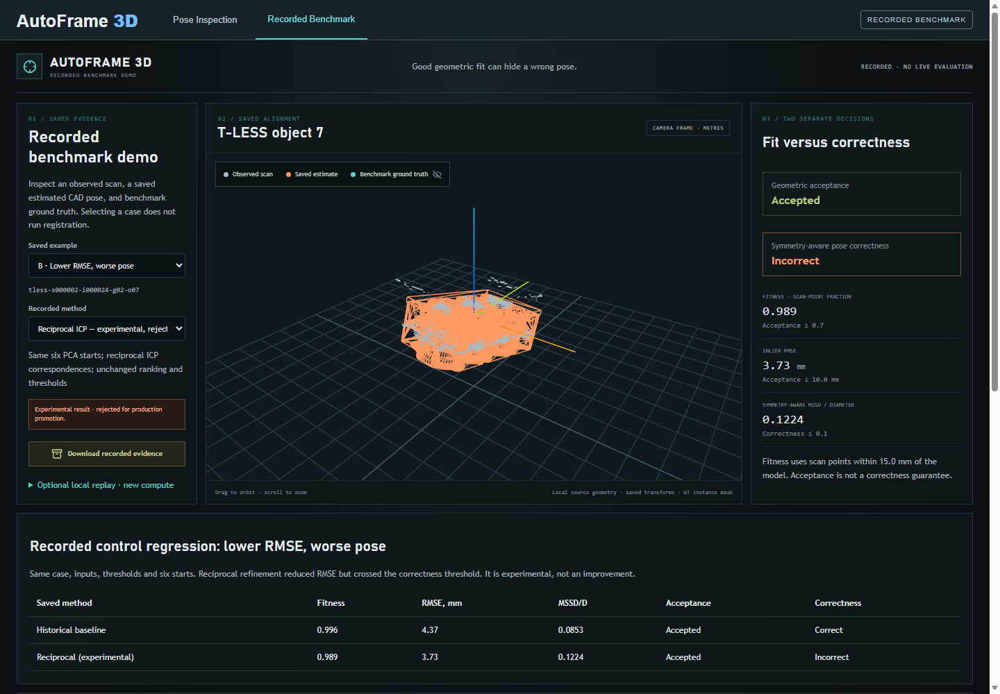
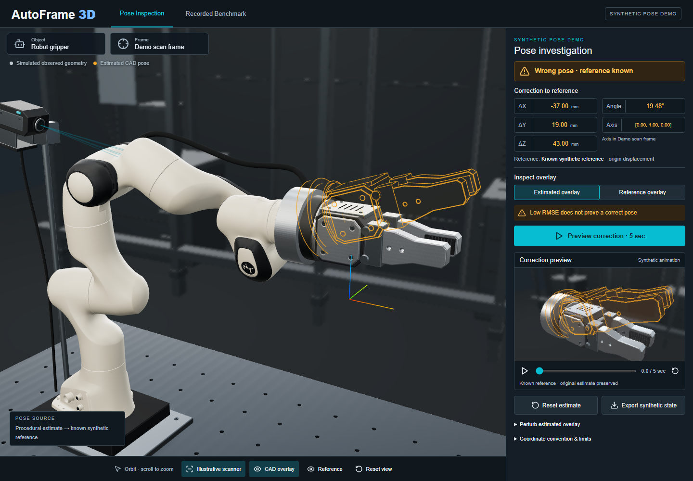
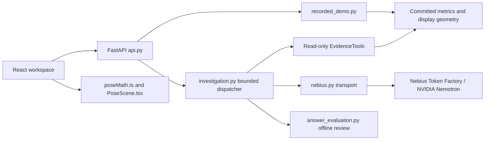

# AutoFrame 3D

**Inspect why a good geometric fit can still be the wrong pose.**

AutoFrame 3D gives CAD-to-scan reviewers a concrete evidence workflow: inspect
saved geometry and poses, compare recorded registration methods, reveal
benchmark ground truth, and export the supporting records. Two curated T-LESS
examples make geometric acceptance and benchmark correctness visible as
separate decisions. An experimental NVIDIA Nemotron copilot can request
read-only evidence through Nebius Token Factory; it cannot modify poses.

This release demonstrates recorded inspection and a synthetic preview. Current
live inference has not been verified. It does not establish autonomous pose
recovery, GT-free failure detection, industrial safety or broad accuracy.

## Contents

[Problem and workflow](#problem-and-workflow) · [Screenshots](#screenshots) ·
[Modes and features](#modes-and-features) · [Architecture](#architecture) ·
[NVIDIA and Nebius](#nvidia-and-nebius) · [Quick start](#quick-start) ·
[Judge walkthrough](#judge-walkthrough) · [Metrics](#metrics-and-evaluation) ·
[Validation](#validation) · [Troubleshooting](#troubleshooting) ·
[Repository and contributions](#repository-and-contributions) · [Licensing](#licensing)

## Problem and workflow

Fitness and inlier RMSE describe local geometric agreement. Similar shapes,
symmetries and partial observations can yield an accepted fit at an incorrect
pose. AutoFrame 3D exposes the saved fit alongside a separate GT-scored pose
metric so a reviewer can inspect the disagreement rather than treat a fit
threshold as confidence in correctness.

Reviewers can select two saved cases, orbit the geometry, toggle benchmark GT,
compare available recorded methods, inspect thresholds/provenance and download
evidence. Case B demonstrates a recorded reciprocal refinement with lower RMSE
but worse benchmark correctness; it is labelled experimental and rejected for
production promotion. Opening these views performs no registration.

## Screenshots



Actual production UI: saved reciprocal method, accepted geometry, incorrect
GT-scored pose and baseline comparison. The curated case is not a benchmark-wide claim.



Actual synthetic workspace: known-reference overlay and five-second preview,
not scanner acquisition or physical robot control. [Image notices](docs/screenshots/NOTICE.md).

## Modes and features

| Mode | What runs | Evidence and maturity |
| --- | --- | --- |
| Recorded Benchmark | Saved geometry, transforms, metrics and comparison cards; JSON export | Locally verified; two curated GT-assisted examples, no fitting on open |
| Pose Inspection | Procedural gripper, pose math, five-second interpolation, pause/reset/export | Locally verified synthetic visualization; reference is known |
| Synthetic research experiments | Seeded generated geometry and bounded classical registration/search via CLI | Separate computation; synthetic results do not establish real sensor behavior |
| Experimental live copilot | NVIDIA model selects approved evidence tools and produces cited prose | Implemented; historical successes and failures preserved, current live validation unperformed |

The UI separates deterministic evidence-scope disclosures from generated prose.
Operational errors are alerts, not model abstention or cached answers. An
unavailable comparison reports that no comparison exists for that case; it does
not fabricate a method or satisfy an evaluator's requested comparison.
Optional raw-data/historical fitting workflows are research paths: the saved
reciprocal runner currently lacks `_refine_icp` and is not release-verified.

## Architecture



`recorded_demo.py` serves saved poses/cards; it does not refit. `poseMath.ts`
computes synthetic transforms in a shared scan frame. `investigation.py`
validates model actions and citations before returning an answer. The offline
evaluator checks returned records against authoritative cards; human review
is still required for entailment, completeness, omissions and unsupported claims.

## NVIDIA and Nebius

The default configured NVIDIA model is **`nvidia/Nemotron-3_5-Lightning`** in
[nebius.py](autoframe3d/nebius.py). `NEBIUS_MODEL` may select another NVIDIA
Nemotron identifier; exact availability must be validated, not inferred from
identifier syntax. Nebius Token Factory supplies server-side inference at
`https://api.tokenfactory.nebius.com/v1/chat/completions`, with bearer authentication.
The frontend never receives the key.

Nemotron chooses JSON-schema actions: `list_available_cases`,
`get_case_evidence`, `compare_recorded_methods`, `get_benchmark_summary`, then
synthesizes or returns insufficient evidence. The application validates approved
IDs/arguments, computes labels from frozen metrics, tracks provenance and
requires retrieved citations. The model does not register geometry or change GT.

| Investigation limit | Enforced value |
| --- | --- |
| Model requests per investigation | 3 maximum; no retries |
| Read-only tool attempts | 6 total, invalid attempts included |
| Investigation deadline | 60 seconds |
| Request timeout | At most 20 seconds and remaining deadline |
| Output tokens per request | 1,200 |
| Provider response | 32 KiB maximum accepted; one extra byte detects overflow |
| Question / parsed content | 1,500 / 12,000 characters |

Strict schemas, evidence validation and operational failures remain enforced.
HTTP redirects are rejected to avoid extra requests or credential forwarding.
[Current primary-source compatibility review](docs/final-release-verification.md)
records the endpoint/model/schema checks. Historical captures are not proof of
current endpoint availability or current prose quality.

## Quick start

Tested host: Windows 11, Python **3.13.7**, Node **24.14.1**, npm **11.11.0**.
Use a recent Node version compatible with Vite 7 (Node 22.12+ or 24 recommended)
and Python 3.10+; other OS/version combinations are not verified here.
Git, Python and Node/npm are prerequisites. No key, full T-LESS download or GPU
is needed for bundled recorded/synthetic views.

From the repository root, install an editable checkout and locked frontend:

```powershell
python -m venv .venv
.venv/Scripts/python.exe -m pip install -e '.[test]'
npm.cmd ci --prefix frontend
```

Keep `demo_assets/`, `audit_evidence/` and `frontend/public/assets/` beside the
source. Standalone wheel execution is not verified: runtime data live outside
the Python package. Prior clean setup is documented in [setup verification](docs/setup-verification.md);
this task reused installed dependencies rather than claiming a new-machine install.

Backend terminal (choose a free port; do not stop someone else's server):

```powershell
$env:AUTOFRAME3D_SKIP_DOTENV='1'
Remove-Item Env:NEBIUS_API_KEY -ErrorAction SilentlyContinue
.venv/Scripts/python.exe -m uvicorn autoframe3d.api:app --host 127.0.0.1 --port 8000
```

Frontend terminal:

```powershell
npm.cmd run dev --prefix frontend -- --port 5173 --strictPort
```

Open <http://127.0.0.1:5173>. The Vite development proxy expects API port 8000.
Stop your own servers with Ctrl+C. Actual release UI verification used separate
ports and a production bundle; it did not attach to another checkout's services.

### Offline and live configuration

`api.py` reads a root `.env` by default and preserves existing process values.
`AUTOFRAME3D_SKIP_DOTENV=1` disables that file access. The commands above disable
it and remove the process key to guarantee the key-free judge path. Do not put
credentials in frontend variables, source, captures or committed commands.
The diagnostic/evaluation scripts do not load `.env` at all.

The one approved bounded sequence is available through a secure hidden-input
launcher. It puts the credential only in the child process environment, trims
surrounding whitespace, rejects internal whitespace/control/non-ASCII bytes,
and cleans references and unmanaged BSTR memory in `finally`:

```powershell
& ./scripts/run_release_validation.ps1
```

Running this command makes paid requests: **one diagnostic**, then only if it
succeeds, one attempt each for development dev-01/dev-02/dev-13, **ten requests
maximum**. It stops subsequent items on HTTP/configuration rejection, performs
no retries and writes fresh GUID output under `artifacts/release-live-*/`.
Do not rerun failed items under the same authorization. Review actual answers
and cards; summary/exit status does not certify semantics. [Review checklist](docs/final-release-verification.md).
This launcher was tested with offline transports, not executed live in that release task.

For the next explicitly authorized **investigation-only** scope, use
`& ./scripts/run_release_validation.ps1 -InvestigationOnly`. This skips the
separate diagnostic and attempts only dev-01/dev-02/dev-13 once each, with a
**nine-request maximum** and unchanged investigation limits/stop conditions.
It records the diagnostic as not run and creates a fresh GUID output directory.
The previous user-run diagnostic received a provider response but truncated
at 128 completion tokens; that remains a failed diagnostic, not valid output
or grounded-answer evidence. The default command above retains its diagnostic
gate. Do not run both commands for this authorization or retry failed items.

## Judge walkthrough

1. Open **Recorded Benchmark**, select **A · Geometrically accepted, incorrect pose**, then
   toggle **Benchmark ground truth**. Compare **Geometric acceptance** with
   **Symmetry-aware pose correctness** and read GT-mask/benchmark-GT disclosures.
2. Select **B · Lower RMSE, worse pose**, switch **Recorded method** from
   historical baseline to reciprocal. Inspect lower RMSE and the correctness
   regression; the experimental label remains visible.
3. Choose **Download recorded evidence**. The JSON contains saved cases,
   method records, thresholds and provenance; it is not a new registration.
4. Return to **Pose Inspection**. Use **Preview correction · 5 sec**, pause,
   **Reset estimate**, and **Export synthetic state**. The export preserves the
   original estimate and labels its synthetic known-reference provenance.
5. The **Experimental live copilot** reports missing-key availability honestly.
   Only use a live answer if actually obtained; never present fixture output as inference.

See the [2:45 narration and judge instructions](docs/submission-ready.md).

### Separate synthetic experiment

To compute a seeded full-visibility control (separate from opening either UI):

```powershell
.venv/Scripts/python.exe -m autoframe3d.cli run --object near_symmetric --visibility all --seed 41 --yaw 0 --output artifacts/synthetic-control
```

This writes a newly computed synthetic result. It uses generated geometry and
its own thresholds; it is not a T-LESS result or live inference. Inspect
[CLI implementation](autoframe3d/cli.py) and [experiment code](autoframe3d/experiment.py)
for the bounded classical registration path. Do not run raw-data replay as part
of the key-free recorded judge walkthrough.

## Metrics and evaluation

For the curated recorded T-LESS cases, geometric acceptance requires
**fitness >= 0.70 and inlier RMSE <= 10 mm**. Fitness is a scan-point fraction;
RMSE is an observed recorded residual. The **15 mm correspondence gate** is
configured matching distance, not a measured distance or a third acceptance test.
Benchmark correctness requires symmetry-aware **MSSD / object diameter <= 0.10**,
using benchmark GT and model symmetry metadata. GT instance masks and known
object identity were inputs. GT-assisted inputs are distinct from GT scoring.

Case B's saved baseline RMSE is about **4.37 mm**, reciprocal **3.73 mm**;
normalized MSSD changes from **0.0853** (correct) to **0.1224** (incorrect).
Both satisfy geometric acceptance. These are saved case metrics, not a measured
success rate. The broader historical corrected 200-case audit reports 24
accepted-and-correct / 176 accepted-but-wrong, with 21 affected records rescored
and 179 carried forward; it is not a complete independent rescore or a new run.
See [benchmark report](BENCHMARK_REPORT.md) and [scoring audit](audit_evidence/symmetry_scoring_audit_20261011_02a10626368f/README.md).
Synthetic experiment thresholds differ; do not substitute them into this table.

## Validation

The dated [release verification](docs/final-release-verification.md) records
exact tests/build/UI results and implementation commit identity. Original rubric,
GT values, dataset identities and historical captures are unchanged.

| Historical live record | Actual result |
| --- | --- |
| Original three-item dev-01 | Supported numerical/RMSE comparisons; omitted recorded/GT qualifications; no measured-gate claim |
| Earlier separate dev-01 | Unsupported measured 0.015 m gate claim; separate capture |
| Original dev-02 | Requested unavailable single-method comparison; failed tool validation |
| Original dev-13 | Truncated on turn 3; partial output rejected |
| Later dev-02/dev-13 | HTTP 401 with invalid_request_error category; one request each, zero tools/findings; underlying cause unresolved |
| This task | Zero provider requests; credential unavailable, current live/manual validation unperformed |

The original batch attempted 3/15 development items, not the whole split; the
later batch attempted 2/15 separately. Unattempted items remain in denominators.
Schema, citation and structured-number checks do not prove prose correctness.
[History and rubric-linked review](docs/evidence-grounding-validation.md).

## Troubleshooting

| Symptom | Evidence-supported action |
| --- | --- |
| Live analysis unavailable | Configure a key securely in the backend process for live use; recorded/synthetic views need none |
| HTTP 401 | Preserved captures establish status/category only. Check authorized account/key provisioning through official controls; no expired-key, billing or model cause is established |
| HTTP schema rejection | Review sanitized status/field locations and named name/schema envelope; no raw provider body is needed |
| Truncation / finish_reason=length | Partial answers are rejected; inspect usage/trace. Do not increase budgets or retry silently |
| Port already occupied | Use a free port and matching proxy configuration; leave existing services alone |
| Node heap allocation failure | Use explicit small heaps below; host memory pressure caused failures during this task |
| Historical reciprocal runner fails | `_refine_icp` is missing; research fitting reproduction is incomplete, not a recorded-viewer failure |
| Missing source dataset | Use bundled display geometry for inspection; raw-data preparation/replay needs separately authorized inputs |

Verification commands from the root:

```powershell
$env:AUTOFRAME3D_SKIP_DOTENV='1'
.venv/Scripts/python.exe -B -m pytest -q --tb=short -p no:cacheprovider
node --test frontend/tests/*.test.mjs
node --max-old-space-size=384 --max-semi-space-size=2 frontend/node_modules/typescript/bin/tsc -b frontend
Push-Location frontend
try { node --max-old-space-size=384 --max-semi-space-size=2 node_modules/vite/bin/vite.js build } finally { Pop-Location }
```

The full backend command exposes the known historical fitting failures; see the
verification record for the separately tested release suite. The production
bundle still has a >500 kB advisory. No Linux, hosted service, standalone wheel,
raw-data refit or current live answer is certified by these checks.

## Repository and contributions

| Path | Purpose |
| --- | --- |
| `autoframe3d/recorded_demo.py`, `demo_assets/` | Portable saved-evidence viewer and two display bundles |
| `autoframe3d/investigation.py`, `nebius.py` | Bounded evidence workflow and provider transport |
| `autoframe3d/answer_evaluation.py` | Offline protocol/fact scoring with manual semantic review |
| `frontend/src/` | Recorded workspace, synthetic scene, pose math and evidence disclosures |
| `scripts/validate_release_live.py` | One diagnostic plus authorized three-item sequence, ten-request cap |
| `scripts/run_release_validation.ps1` | Secure process-scoped direct launcher |
| `scripts/prepare_demo_assets.py` | Hash-checked local geometry preparation |
| `tests/`, `frontend/tests/` | Backend, browser and frontend verification |
| `audit_evidence/` | Preserved results, rubric, provenance and audits |
| `docs/` | Requirements, permissions, verification and submission materials |

Git history during the submission period records Windows setup/saved-pose
handoff (`8e539ac`), recorded evidence and diagnostic repairs (`02983c6`,
`88a3e73`, `588f514`), evidence-scope/grounding fixes (`8ea46fb`, `445444d`,
`61191f4`) and MIT/submission text (`cf8b960`). This release adds stricter
completion scoring, configured-model probing, bounded orchestration and product
verification. Repository authors are **Muskan Ejaz** and **Juwairiya-Haroon**;
the handoff identifies Muskan as lead and Juwairiya as engineering contributor.
Git author labels do not establish who personally performed every change;
final roles, eligibility and coding-assistance disclosure need owner review.
AI coding assistance was used for release repair, tests and documentation.

## Licensing

Original project code is [MIT](LICENSE), approved by both owners. Third-party
material keeps its own terms: Panda Apache-2.0, Poly Haven HDR CC0, original
local scene assets under their existing MIT notice, dependency licenses and
T-LESS attribution/ShareAlike bundle terms. No third-party material is relicensed.
[Asset notices](frontend/public/assets/industrial/NOTICE.md) ·
[Dataset attribution](demo_assets/ATTRIBUTION.md) · [Permission review and alternative setup](docs/data-permissions.md).
The exact T-LESS governing source grant remains ambiguous; publication review
must address that question, not treat project MIT as a data permission.

## Release and submission materials

[Submission description, 2:45 demo and judge setup](docs/submission-ready.md) ·
[Current organizer requirements](docs/hackathon-requirements.md) ·
[Release verification](docs/final-release-verification.md) ·
[Detailed historical grounding review](docs/evidence-grounding-validation.md) ·
[Recorded demo](DEMO.md) · [Synthetic preview](POSE_INSPECTION.md).

**Public video URL: pending. Judge access URL: pending.** No deployment, push,
video upload or submission was performed. Current live verification, exact data
permissions review, final attribution and public access remain owner actions.
